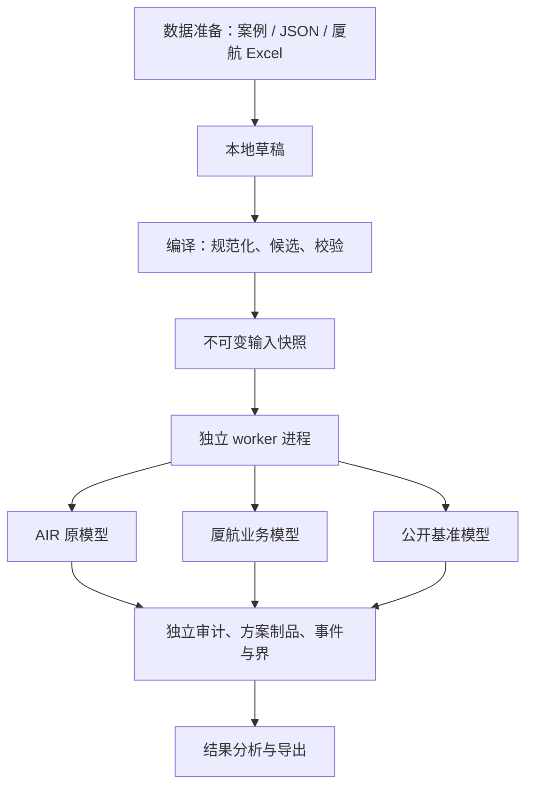

# Workbench v3 技术路线、数据与数学模型全景说明

整理日期：2026-11-14（北京时间）。完成核对时 HEAD：`3a54de66749c3ee267c7068f78e34d0341c2756a`。查阅期间新增的该提交仅归档三份报告；应用代码与开始核对时的 `3ed21d6` 相同。本文同时使用本地冻结数据和已有实验记录。

本文面向需要理解、使用或继续研究本项目的人：先解释系统在解决什么问题，再介绍数据、决策变量、目标函数、约束、算法输入输出和已有证据。公式是对当前实现的归纳；涉及简化的地方明确标注，不把功能存在等同于业务完整或性能已经验证。

本次以本地代码、配置、冻结输入和实验记录为依据，没有重新运行正式求解，也没有重新核验外部网站。代码行为优先于旧说明；历史实验结论仍以当时冻结版本为准。

## 阅读导航

- 只想掌握现状：读第 1、2、10、11 节。
- 想弄清模型：读第 3—6 节，尤其是三个模式之间的差异。
- 想理解自研算法：读第 7、8 节。
- 想使用或复现实验：读第 9、12 节及附录。

## 1. 当前项目究竟是什么

项目围绕“航班发生扰动后，如何调整航班、飞机、机组和旅客安排”展开。最初的主线是 AIR 综合恢复研究模型，后来加入厦航／天池业务模型和公开数据基准。

**Workbench v3 是统一的研究操作台。它组织输入、配置、求解、分析和证据，并不意味着所有数据都使用同一套数学模型。**

### 1.1 三个问题家族

| 家族 | 求解合同标识 | 优化对象 | 旅客与容量 | 时间与目标单位 |
|---|---|---|---|---|
| 原始 AIR | `schema_version=1.0.0`；`benders_branch_and_price_v1` | 航班、飞机、机组、旅客 | 不可拆分 OD 旅客组；外生测试／剩余座位 | 工作台按 UTC 展示；抽象成本 |
| 厦航业务研究 | `xma-solve-1.0`；`model_mode=xma_research` | 航班、飞机、航段旅客账本与改签；机组和维修关闭 | 整数人数可拆分改签；容量随选定飞机变化 | 北京时间；天池评分或 AIR 研究成本 |
| 公开基准研究 | `public-benchmark-1.0` | 飞机，或飞机＋旅客；机组关闭 | ROADEF 原始整组行程；同座位配置换机下的固定容量 | UTC；`public_air_linear_v1` 抽象成本 |

例如，“旅客不能拆组”是 AIR／公开整组模型的规则；“可以将 10 人分成 6 人和 4 人改签”属于厦航人数模型。不能把这两种结果当成同一个问题的不同算法答案。

### 1.2 v3 的工程结构



- 前端：`frontend/v3/src`，React＋TypeScript；三个工作区是“数据准备”“配置与运行”“结果分析”。
- 通信：复用 `/api/v2` 和 `/api/cases`，没有另建 `/api/v3`。
- 后端：FastAPI＋Pydantic；`backend/workbench/worker.py` 根据求解合同分派。
- 持久化：`.workbench/` 的 SQLite/WAL 索引和内容寻址的 gzip JSON 制品。草稿可以继续改，历史快照不随之改变。
- 求解：原 AIR 正式服务使用 Gurobi；公开模型显式选择 HiGHS／Gurobi；厦航支持 `auto/highs/gurobi`。
- 默认入口：存在 v3 构建时，访问服务根路径会跳转至 `/static/workbench-v3/index.html#/prepare`；v2 和 legacy 入口保留。

“v3”“API v2”“输入 1.0.0”分别是界面、接口和数据合同的版本号，不矛盾。

## 2. 先分清三个经常混用的概念

### 2.1 数学模型、算法、求解器

| 层次 | 回答的问题 | 项目里的例子 |
|---|---|---|
| 数学模型 | 什么决定可以改？必须满足什么？怎样算代价？ | 航班取消与延误、飞机连续性、旅客容量、天池评分 |
| 算法路线 | 怎样把这个模型组织起来求解？ | 一次性 MIP、Benders、列生成、分支定价 |
| 求解器 | 谁实际执行 LP／MIP 优化？ | HiGHS、Gurobi |

换 HiGHS 不等于换模型；将同一问题从直接模型改成 Benders，也不应偷偷改变候选、成本或边界。

### 2.2 候选、完整路径和变量

一班航班可以有“准点、延误 30 分钟、延误 60 分钟、取消”等候选。选哪个候选是一类决策；让哪架飞机执行是一类决策；给某架飞机串成一整天的合法路径，又是一种表示方式。

**列生成增加的是已有航班候选组合成的飞机路径或机组串，通常不创造新的起飞时刻。** 因而“隐式考虑完整路径”也不意味着考虑了连续时间上的所有恢复方案。

### 2.3 校验、可行和最优

1. 数据校验：字段、引用、时间和配置是否自洽。
2. 输入就绪：求解所需数据是否齐全。`solve_ready=true` 不保证优化可行。
3. 可行：找到一套同时满足当前模型约束的完整方案，并通过独立复核。
4. 最优：还需有效下界与该方案的上界闭合，并有符合算法合同的终止证据。

最小化问题中，LB 表示“任何方案都不可能比这个更便宜”，UB 表示“已有合法方案的成本”。常用相对差距为：

\[
\mathrm{Gap}_{rel}=\frac{UB-LB}{\max(1,|UB|)}.
\]

没有合法方案就没有可用 UB；不能借另一条算法的答案填成本路线的 UB。某个资源 LP 的界也不能直接冒充整个恢复问题的界。

## 3. 数据资产：有哪些、放在哪里、能说明什么

### 3.1 数据总览

| 资产 | 本地位置 | 内容与用途 |
|---|---|---|
| AIR 案例目录 | `data/cases/catalog.json` | 8 个可供工作台克隆的正式案例入口，含预期与边界案例 |
| AIR 原始场景 | `data/examples/` | 微型、综合、机组整数性、生成器、Scope 等场景 |
| 人工预期与回归参照 | `data/expected/` | 与指定案例配套的预期选择、恢复指标和目标；不应拿来覆盖算法实际输出 |
| 显式候选 | `data/columns/` | Flight Options、飞机串、机组串、旅客行程；部分用于组件 Oracle，不是正式服务直接输入 |
| 容量／成本／算法配置 | `data/capacities/`、`data/costs/`、`data/config/` | 与场景和候选配套的独立合同 |
| 确定性验证套件 | `data/validation_suite/` | 20 个微例、P1—P5 压力数据、预期、覆盖矩阵、生成种子与校准信息 |
| 厦航原始资料 | `data/厦航-天池比赛数据/data/` | `XMAE_data.xlsx`、评估器 JAR 和 Java 源码 ZIP |
| 三组公开资料 | `data/航班恢复数据下载_3个公开数据/公开基准数据/` | ROADEF 2009、TU Delft 2020 输入、TU Delft 2019 结果资料 |
| 正式冻结实验 | `.public_benchmarks/` | 每批的源码、输入、清单、任务、日志、方案、审计与汇总；不等于普通示例数据 |
| 工作台运行状态 | `.workbench/` | 草稿、不可变快照、事件及方案制品；也包含历史隔离验收和长测目录 |

不要把 `.workbench/**/source/` 或 `.public_benchmarks/**/source/` 中的旧源码副本，当成当前主工作区代码。它们是历史实验的证据。

### 3.2 AIR 的基本数据合同

`Scenario` 是“原计划和外部条件”，`RecoveryColumns` 是“可供选择的恢复方案”，两者不能互相替代。

| 实体 | 关键字段 | 含义及重要边界 |
|---|---|---|
| 恢复窗口 | `start_time/end_time` | 决策与候选的时间边界；时间戳必须带时区 |
| 航班 | `flight_id, origin, destination, sched_dep, sched_arr, duration` | 原时刻、起讫点与分钟级飞行时长 |
| 原资源与标记 | `original_aircraft, original_equipment, original_crew, strategic_flag, market_flag, min_seats, max_delay` | 原分配、保飞要求与最大延误；`min_seats` 不是飞机物理座位 |
| 扰动相关航班字段 | `earliest_departure, fixed_delay, cancel_required` | 最早起飞、固定延误、必须取消；公开转换器显式赋予来源语义 |
| 飞机 | `tail_id, equipment_type, initial_station_at_t, required_station_at_T_end, original_rotation` | 机尾归属、机型、初始位置和硬终端位置 |
| 飞机边界 | `ready_at, available_until, unavailable, boundary_from_fixed_context` | 窗口外上下文带来的可用时间与位置；原 AIR 案例通常不使用公开边界扩展 |
| 飞机维护 | `maintenance_required, maintenance_stations` | 简化维护要求；不是完整维修任务、工时与机库排程 |
| 机组 | `crew_id, rating, start_station_at_t, required_station_at_T_end, original_duties, original_pairing` | 一个聚合机组单元；原职责展平后应等于原 pairing |
| 旅客组 | `pax_group_id, count, origin, destination, original_departure, scheduled_arrival, original_itinerary` | 按整组选择行程；人数不是连续流量 |
| 机场时段 | `airport, start_time, end_time, arr_capacity, dep_capacity, gate_capacity` | 起降架次和聚合地面库存上限；不是旅客座位 |
| 场景扰动 | `disruptions` | 旧场景中的扰动描述；工作台另有可编译的类型化规则，防止重复扣减容量 |

候选列有四种：

- `FlightOption`：执行／取消／调机；含基准航班引用、起讫点、实际时刻、延误和变更类型。取消候选不带实际起降字段；调机没有基准收入航班。
- `AircraftString`：某一机尾拥有的有序 `leg_option_ids`，带起终点和维护满足标记。
- `CrewPairing`：某一机组拥有的 duties／segments；段类型包括 `operate/deadhead/ground_transfer/rest`。结构能表示某类段，不代表正式生成器已覆盖全部业务规则。
- `PassengerItinerary`：某旅客组的已运输或未服务方案；已运输有航段和到达延误，未服务不携带旅行字段。

容量合同 `seat_capacity_by_option_id` 把座位绑定到执行候选。原 AIR 中它是外生剩余容量，不随换机自动改变。候选上的 `cost_components` 也不是可任意信任的最终成本，规范成本函数会重新计算。

### 3.3 AIR 案例及验证套件

工作台正式目录中的案例如下。预期值是固定输入下的回归参照，不是随便修改配置后仍应满足的答案。

| Case ID | 用途 | 原配置预期 |
|---|---|---|
| `benchmark-disruption-recovery` | 综合恢复：12 航班、4 飞机、5 机组、8 旅客组 | 最优成本 18,080；3 班共延误 80 分钟，2 次换机，0 未服务旅客 |
| `crew-recovery-integrality` | 检验机组整数性和分支定价 | 95,200；覆盖仅用 LP 不能闭合的情况 |
| `passenger-capacity-constrained` | 原候选座位不足，迫使选择延误方案 | 1,010 |
| `passenger-capacity-relaxed` | 同一问题放宽原候选剩余座位 | 0 |
| `delay-cost-cancellation-tradeoff` | 高延误成本与未服务成本权衡 | 25,000；预期原时刻、10 人未服务，不能只按案例名称猜测决策 |
| `solve-ready-infeasible` | 数据就绪但数学问题不可行 | `infeasible` |
| `scenario-only-minimal` | 仅供场景编辑、校验与影响展示 | 场景有效，尚无完整求解包 |
| `invalid-missing-airport` | 错误引用负例 | 场景无效 |

20 个微例进一步覆盖飞机对航班选择的反向耦合、Scope 闭包、飞机／旅客候选生成、固定列 Benders、飞机／机组 CG、Benders-CG、机组根节点整数间隙等。附录给出逐项索引。

压力套件实际规模如下，“秒级／分钟级”是目标时间带，不能当成性能承诺：

| 档位 | 航班 | 飞机 | 机组 | 旅客组 | 航班候选 | 旅客行程 | 原有校准状态 |
|---|---:|---:|---:|---:|---:|---:|---|
| P1 | 12 | 4 | 5 | 8 | 22 | 55 | 本地约 1.3—1.7 秒 |
| P2 | 12 | 3 | 3 | 12 | 36 | 42 | 70 秒预算下受控中止 |
| P3 | 20 | 6 | 6 | 30 | 60 | 102 | 未校准 |
| P4 | 40 | 12 | 13 | 80 | 160 | 412 | 未校准 |
| P5 | 72 | 21 | 24 | 250 | 360 | 1,764 | 未校准 |

后续还有独立的长测活动，原始证据位于 `.workbench/validation_campaigns/`。不能把这些历史活动、套件目标带、公开基准实验和浏览器性能测试合并成一个性能结论。

### 3.4 厦航七表

主输入是 `XMAE_data.xlsx`。导入器保留工作表、原行号和文件 SHA-256。

| 工作表 | 内容 | 已有本地资料规模 |
|---|---|---:|
| 航班 | 日期、航班号、国内国际、时刻、机尾机型、普通／联程人数、座位、重要系数 | 2,364 班；142 飞机、4 机型 |
| 航线-飞机限制 | 禁止某机尾飞某 OD | 8,693 行 |
| 机场关闭限制 | 每日关闭／开放时刻及生效日期 | 6 行 |
| 台风场景 | 禁起飞、禁降落、停机上限 | 11 行 |
| 飞行时间 | 机型与 OD 的分钟飞行时间 | 8,703 行；1,464 个重复键行，按源码后写覆盖，原行仍保留 |
| 机场 | 机场及国内国际属性 | 79 个机场 |
| 中转时间限制 | 进港、出港、最短中转时间、人数 | 773 行 |

原轮转中识别 616 对联程；有 48 班原始超售、212 个原相邻过站不足 50 分钟。5 个同机场起降记录在业务合同中保留，不据此编造维修任务。调整窗口为北京时间 **2017-05-06 06:00 至 2017-05-09 00:00，包含两端**。

子集按完整机尾轮转选择，支持固定或带种子的随机选择，优先覆盖受影响机尾。请求“约 20／50／100／500 班”在当前直接基线实际得到 30／65／103／508 班，原因是完整轮转闭包。选择记录有机尾列表、实际规模和 hash。

### 3.5 ROADEF、Delft 的可用范围

| 来源 | 当前读取范围 | 可用于什么 | 不能直接推出什么 |
|---|---|---|---|
| ROADEF 2009 | 32 组；航班、轮转、飞机、旅客行程、容量、扰动、维护、规则、官方检查器与历史成绩 | 派生研究模型、小例 Oracle、原生方案导出和原规则检查 | 研究成本等于官方成本；历史最好成绩等于全局最优 |
| TU Delft 2020 输入资料 | 196,958 条计划、29,375 条扰动、2,428,789 条连接及辅助表 | 12 小时窗口、跨日期研究、资源边界与连接影响评价 | 已复现发布者原“370 组”编号；连接边际人数就是完整 OD 需求 |
| TU Delft 2019 Results | 6 个 XLSX、32 个表、7,077 条运行观察 | 外部成本、KPI、CV、时间和状态的资料分析 | 有完整输入可逐例重跑；能与 2020 输入自然配对 |

Delft 三个 HDF5 文件是 `Schedule_Q1_2015_def.h5`、`Disruptions_Q1_2015_def.h5`、`Connections_Q1_2015_def.h5`。读取时按分类字典恢复业务 ID，按“航班号＋计划起飞＋起讫机场”匹配，保留原行号。旧 HDF 元数据只解析字符串，不执行下载内容里的 pickle 指令。

2019 资料中 7,044 条符合参考筛选，33 条 `CV != 0`；另有 2 个公式错误单元格和 177 条辅助／汇总记录。错误公式、缺失缓存、非零 CV 不作为可用参考结果；发布者状态 `101` 本身也不是本项目的最优证明。

公开首批冻结了 69 个派生输入：29 个能力预检就绪，40 个不支持，分别为 34 个维护缺口和 6 个语义不明的 `AC Unavailable`。这些是派生输入数量，不等于原始数据集的实例数量。

## 4. 原始 AIR：目标、变量和约束

### 4.1 四个子模型解决什么

| 缩写 | 模型 | 决策 |
|---|---|---|
| SRM | Schedule Recovery Model | 哪班执行、取消、几点飞、是否使用显式改机场候选 |
| ARM | Aircraft Recovery Model | 每架飞机选哪条合法航班串 |
| CRM | Crew Recovery Model | 每个机组选哪条合法执勤串，哪些段执飞、哪些段置位 |
| PRM | Passenger Recovery Model | 每个旅客组选哪条行程，或明确未服务 |

“置位／deadhead”指机组作为乘员移动到后续执勤地点，该段不算其执飞覆盖。“调机／ferry”指飞机的非收入移动。

单独 ARM／CRM／PRM 接收已确定的执行航班集合，不重新选择航班；联合模型通过 linking constraints 把四者绑在一起。

### 4.2 决策变量与统一目标

设 `O_f` 为航班 f 的执行／取消候选，`S_a` 为飞机 a 的合法串，`P_k` 为机组 k 的合法串，`I_g` 为旅客组 g 的候选行程。

| 变量 | 类型 | 取 1 的含义 |
|---|---|---|
| `x_o` | 二元 | 采用航班候选 o |
| `y_s` | 二元 | 采用飞机串 s |
| `z_p` | 二元 | 采用机组串 p |
| `w_i` | 二元 | 旅客组采用行程 i，包括未服务行程 |

\[
\min Z=\sum_o c_o^Sx_o+\sum_s c_s^Ay_s+\sum_p c_p^Cz_p+\sum_i c_i^Pw_i.
\]

每项成本只由一个模块负责，避免重复计费。基准配置 `data/costs/phase2_test_costs_v1.json` 的 `cost_profile_id` 是 `phase2_test_v1`：

| 成本键 | 默认值 | 计费依据 | 归属 |
|---|---:|---|---|
| `flight_delay_per_minute` | 1 | 每班起飞延误分钟 | SRM |
| `flight_cancellation` | 25,000 | 每班取消 | SRM |
| `origin_change` | 5,000 | 每个明确起点变更候选 | SRM |
| `destination_change` | 5,000 | 每个明确终点变更候选 | SRM |
| `aircraft_reassignment` | 0 | 每个执行航班由非原机尾执飞 | ARM |
| `ferry_per_minute` | 5 | 调机航段 block 分钟 | ARM |
| `crew_reassignment` | 0 | 每个执行航班由非原机组执飞 | CRM |
| `deadhead_per_minute` | 5 | 机组置位 block 分钟 | CRM |
| `passenger_delay_per_pax_minute` | 10 | 整组人数×最终到达延误分钟 | PRM |
| `unserved_passenger` | 2,500 | 每个未服务旅客 | PRM |

这些是研究／测试成本，不是已校准的现实货币。部分数量级来自论文，起降机场变更、每分钟调机／置位等是明确的实现假设。override 只改变非负有限系数，不改变 owner、单位和出处。

综合例中的成本可以人工理解为：航班延误 80 分钟×1，加旅客加权到达延误 1,800 人分钟×10，合计 18,080。换机默认价格为 0，不能据此认为方案没有换机。

### 4.3 选择和资源覆盖

每班、每机、每组、每个旅客组都必须做唯一选择：

\[
\sum_{o\in O_f}x_o=1,\quad
\sum_{s\in S_a}y_s=1,\quad
\sum_{p\in P_k}z_p=1,\quad
\sum_{i\in I_g}w_i=1.
\]

执行收入航班候选 o 必须恰好有一架飞机和一个聚合机组覆盖：

\[
\sum_s A^A_{os}y_s=x_o,\qquad
\sum_p A^{C,op}_{op}z_p=x_o.
\]

这里 `A` 是候选包含关系：例如某飞机串含 o，对应系数为 1。取消候选不需要飞机或机组覆盖。

### 4.4 五类联合耦合

| 代码 ID | 公式／含义 |
|---|---|
| `INTEGRATED-L01-SCHEDULE-AIRCRAFT` | 飞机覆盖量＝执行候选选择量 |
| `INTEGRATED-L02-SCHEDULE-CREW` | 机组 OPERATE 覆盖量＝执行候选选择量 |
| `INTEGRATED-L03-DEADHEAD-SCHEDULE` | 对 pairing 中每个置位航班，`z_p ≤ x_o`，取消的航班不能用来置位 |
| `INTEGRATED-L04-PASSENGER-SCHEDULE` | 对行程每个航段，`w_i ≤ x_o` |
| `INTEGRATED-L05-SEAT-SCHEDULE` | `Σ_i n_g A^P_oi w_i ≤ seat_capacity[o] x_o` |

容量右边是候选自带的外生剩余座位，原 AIR 没有把它改成“选中机尾的物理座位”。上式也没有自动把 deadhead 机组人数计入旅客座位负载；不能把 L03 的存在理解为已完整建模置位占座。

### 4.5 原 AIR 约束完整分类

注册表共有 20 个约束 ID，附录列出精确 ID。下面解释它们实际表达的意思。

| 模块 | 约束 | 当前实现及边界 |
|---|---|---|
| SRM-C01 | 每班唯一候选 | 执行或取消必须显式选一项 |
| SRM-C02 | 战略航班保留 | 战略航班执行候选之和为 1 |
| SRM-C03／C04 | 到达／出发容量 | 机场半开时段内选中航班架次不超过上限 |
| SRM-C05 | 地面库存代理 | 初始在地飞机＋累计到达－累计出发，位于 0 和 gate 上限之间；不是逐机尾机位占用 |
| SRM-C06 | 市场服务代理 | `market_flag` 且 `min_seats>0` 时不允许取消；没有形成真实座位供给下限 |
| ARM-C01／C02 | 每机一串、候选覆盖 | 固定计划下要求航班覆盖恰好一次，未要求航班不允许混入 |
| ARM-C03 | 终点 | 选中串必须回到该机尾要求的终点 |
| ARM-C04 | 维护 | 需要维护的机尾只能选维护满足的合法串；以当前简化维护语义为界 |
| ARM-C05 | 路径合法 | 机尾归属、机型、地点、时间连续性等前置校验 |
| CRM-C01／C02 | 每组一串、执飞覆盖 | 一个聚合 crew 单元覆盖执行航班；不是机长／副驾驶／乘务多岗位数量配置 |
| CRM-C03 | 非执行航班禁用 | 非当前计划航班不得被执飞或置位 |
| CRM-C04 | 机组串合法 | 归属、资质、地点、时间；不声称完整 FAR／CCAR 合法性 |
| CRM-C05 | 机组终点与归属 | 机组自己的串，满足指定结束位置 |
| PRM-C01 | 每组唯一行程 | 整组不可拆分，未服务也是显式选择 |
| PRM-C02 | 与计划一致 | 行程只能使用当前执行航班 |
| PRM-C03 | 座位 | 同航段各组人数之和不超过外生剩余容量 |
| PRM-C04 | 行程合法 | OD、先后时序、到达与未服务结构校验；具体 MCT 来自生成配置 |

注册表中有保留自早期阶段的注释，如“以后再考虑 Phase 3”或“没有真实航司 MCT”。联合模型和候选生成器已经演进；理解现状应同时看注册表、实际建模代码和配置。当前 MCT 可以检查，但默认是测试值 0，仍不能称为航司真实 MCT。

### 4.6 候选生成和 Scope

**航班候选编译。** 工作台默认复用已有候选；开启重新生成后，生成原时刻、取消和延误网格，默认步长 10 分钟、最大延误 60 分钟，再受各航班 `max_delay` 限制。该通用编译器按步长生成，不保证额外补上不整除步长的最大延误点。手工候选可补充，重复 ID 会报错。

通用自动生成不自动改航路、不自动调机。合同支持这些候选与正式生成器会自动创建它们，是两件事。有旅客时重新生成必须明确提供按航班的剩余座位；不能凭空推算飞机物理容量。

**飞机串生成（Phase 5）。** 输入场景、已有 Flight Options 和过站配置，建立每机 DAG，搜索满足机型、地点、时间、窗口、终点和简化维护要求的串。默认过站 15 分钟，测试机型 E1 override 为 0。显式 DFS 全枚举用于小例、参考池和审计；正式 CG 定价不调用这个全枚举器。

**机组串生成（Phase 6）。** 基于收入执行候选，区分 OPERATE／DEADHEAD，检查执飞机型资质、连接、执勤跨度、重复资源和终点。当前默认最短连接 0、最长单 duty 480 分钟、最多 1 个 deadhead，允许 idle；没有完整多 duty、过夜休息法规模型。

**旅客行程生成（Phase 7）。** 基于已有收入航班，检查 OD、不得早于旅客出发要求、时间和 MCT、窗口、最多航段数，生成已运输和未服务行程。默认 MCT=0、最多 3 段、允许未服务、不生成地面交通。容量留给 PRM／联合模型处理，不能在单组路径生成时保证全体旅客同时有座。

**Scope（Phase 4）。** 从直接扰动起点，通过航班、飞机、机组、旅客与共享约束不断扩展，直到集合不再变化。固定列 Oracle 中范围外实体固定到唯一原计划候选，完整约束仍保留；这不是删除范围外约束。旧示例有 14→10 个自由 binary 的缩减证据。但原 AIR 正式 Phase 11／12／13 求解入口要求 `scope=None`，v3 目前没有把动态 Scope 接到这条正式主线上。

## 5. 厦航：与 AIR 不同的业务联合模型

### 5.1 候选和时间规则

- 只允许窗口内航班取消或非负延误；窗口外冻结时间、原机尾、取消和送出改签。
- 国内最多延误 24 小时，国际 36 小时，同时受配置 `maximum_delay_minutes` 限制。
- 默认请求参数为步长 30、最大延误 1,440 分钟；**最近直接基线用的是 30／120，不是默认请求的完整延误域**。
- 网格之外补入最大延误点、台风和关闭的关键边界时刻，并过滤非法起降候选。
- 关闭日期为 `[effective, expiration)`；每日关闭和台风禁起降使用严格开区间，边界可起降。容量窗则包含两端。
- 只做同机型换机，排除禁飞 OD—机尾组合；未实现提前、跨机型、调机和联程拉直。

### 5.2 变量

| 变量／代码名 | 类型 | 作用 |
|---|---|---|
| `x[o]` | 二元 | 每班选择执行时刻或取消 |
| `u[tail,o]` | 二元 | 指定机尾执行候选 |
| `board/ground/release/arc/shortcut` | 二元 | 直接模型中的登机、地面等待、释放、结束、特殊衔接流 |
| `path[tail,p]`／数学上 `λ_ap` | 全路径 MIP 为二元；CG 为非负连续 | 用整条飞机路径表达同一资源流 |
| `transfer_fail` | 二元 | 原进港未取消但无法满足中转时间 |
| `overflow` | 非负整数 | 账面人数超过物理座位的部分 |
| `resident`／`resident_part` | 非负整数 | 留在原航班的旅客及其候选分摊 |
| `loss` | 非负整数 | 当前取消／断连／溢出账本中的待恢复人数 |
| `sign[f,o]` | 非负整数 | 从源航班 f 改签到目标候选 o 的人数 |
| `send`、溢出／停机辅助变量 | 二元 | 改签链限制、max 和逻辑条件的线性化 |

厦航模型里的 `sign` 是人数；不要与 AIR 的二元整组行程变量混淆。

### 5.3 航班和飞机约束

1. 每班唯一候选；每个执行候选恰好分配一架飞机：`Σ_a u_ao=x_o`。
2. 每架飞机从原初始机场出发，沿地点连续、时间前进的网络行走；当前厦航模型要求至少执行一段，不能自动假设可完全闲置。
3. 直接模型用机场时间事件压缩普通衔接：落地后一般 50 分钟释放。原相邻短过站用 `min(50, original_turn)` 的专用直达弧，避免错误禁止原有短过站。
4. 联程两段都执行时，必须由同一机尾直接相接；专用 shortcut 直接进入指定后段，不进入共享事件再转去别的航班。
5. 若联程任一段位于调整窗口外，当前规则禁止该对中两段的取消候选。这是最近全量固定网格出现冲突的重要原因。
6. 终点保持的是“机型—机场”的全机队数量：`Σ_a end[a,type,airport]=原终点数量`；没有强制每架机尾回到自己的原终点。公开基准的硬逐机尾终点不同。
7. 台风受影响机场在指定窗口内，起降合计每 5 分钟不超过 2 次；两个窗口用第一窗起点作分桶原点。未给定的正常机场容量不补造。
8. 停机计数遵循源码：相邻执行航班间的地面间隔完整覆盖停机场景才计入；无前序或后序的初始／最终停车不计。同机场多场景贡献累加，不能换成一般瞬时地面库存。

### 5.4 旅客人数账本与改签

设航班 f 的普通人数为 `P_f`、联程人数为 `T_f`。对于窗口内执行航班，先计算取消进港人数 `tc_f`、中转失败人数 `tf_f`、联程搭档取消造成的人数损失 `through_loss_f`，再得到：

\[
N_f=P_f+T_f-tc_f-tf_f-through\_loss_f,
\]

\[
S_f=\sum_{a,o\in O_f^{operate}} seats_a u_{ao},\quad
overflow_f=\max(0,N_f-S_f),\quad resident_f=N_f-overflow_f.
\]

`max` 由整数辅助变量和有界线性约束实现。取消、联程前后段、窗口外航班分别有源码账本规则，不能把所有航班简单套成同一个“原人数－座位”公式。

改签人数 `r_fo=sign[f,o]` 满足：

- 源航班位于调整窗口；目标同 OD，目标起飞不早于源原起飞，且目标候选确实执行。
- 执行源可送出的主要是中转失败和溢出人数；取消源还受源码普通旅客人数上限约束。
- `Σ_o r_fo≤loss_f`，未服务人数为 `loss_f−Σ_o r_fo`。
- 一个航班不能同时送出改签并接收改签，防止改签链。
- 每班实际占座 `resident_f＋Σ_h r_hf≤S_f`。

原数据是航段人数和连接关系；同一个人可能在多段出现。把所有航段人数相加不能得到独立旅客总数。厦航结果因此提供 `passenger_allocations`／账本，而不是假装输出 AIR 式完整 OD 行程。

### 5.5 天池评分：精确到当前受支持动作

令 `v_f` 为航班重要系数、`d_o` 为延误分钟、`c_f` 为取消指示，`a_fo` 为换机指示。目标为：

\[
Z_T=\sum_f v_f(1200c_f+100d_f/60)
+\sum_{f,a,o}v_f\kappa_f a_{fo}
+\sum_o resident\_part_o g(d_o/60)
+\sum_{f,o}r_{fo}h(\Delta_{fo}/60)
+4\sum_f unserved_f.
\]

换机系数 `κ_f`：原计划起飞不晚于调整起日 16:00 为 15，之后为 5。源工作簿对应 2017-05-06 16:00。

驻留旅客每人延误函数：

| 延误小时 t | `g(t)` |
|---|---:|
| `t≤0` | 0 |
| `0<t≤2` | 1 |
| `2<t≤4` | 1.5 |
| `4<t≤8` | 2 |
| `8<t≤36` | 3 |
| `t>36` | 10⁹ |

改签每人延误先截为非负；`Δ` 按目标起飞相对源原起飞计算：

| 延误小时 t | `h(t)` |
|---|---:|
| `0≤t<6` | `t/30` |
| `6≤t<24` | `t/24` |
| `24≤t<36` | `t/18` |
| `36≤t≤48` | `t/16` |
| `t>48` | 10⁹ |

不在调整窗口内的航班留乘与接收改签，天池延误计分按后端规则豁免。模型会把成本高于未服务成本的改签变量上界置 0：改签没有强制最小量，去掉这种选择释放座位，因此这是有证明的支配处理。

这些分段函数不是把非线性函数直接交给求解器：候选时刻已离散化，每个候选的函数值在构模前可计算，乘人数后仍是线性项。最终 Python 评分器从决策重算，不只接受 solver 的目标数值。

### 5.6 厦航 AIR 线性研究目标

\[
Z_A=c_{cancel}\#cancel+c_{delay}\sum_f d_f+c_{swap}\#swap
+c_{paxdelay}\left(\sum_o resident\_part_o d_o+\sum_{f,o}r_{fo}\Delta_{fo}\right)
+c_{unserved}\sum_f unserved_f.
\]

默认系数为取消 25,000、航班每延误分钟 1、换机 0、旅客每人分钟 10、未服务每人 2,500。它作用于厦航人数账本，没有机组成本；即使系数与原 AIR 相同，也没有变成原 AIR 整组模型。天池“分”和抽象成本分别报告，不相加，也不直接比较大小。

## 6. 公开基准：统一后的研究模型及缺口

### 6.1 冻结转换的含义

`PublicSolveRequest` 同时保存：来源及原文件 hash、`scenario`、`recovery_columns`、容量、完整成本、完整算法配置、候选策略、固定上下文、规则映射、能力缺口和 `problem_sha256`。

问题 hash 排除 `algorithm/backend`，允许在同一问题上换算法或求解器；候选、成本、固定上下文等参与 hash。改变研究问题应重新转换，不能只改展示场景绕过冻结校验。

### 6.2 转换规则

| 项目 | 当前实现 |
|---|---|
| 抽样 | 固定种子、优先受扰动机尾，选中机尾保留窗口内完整轮转；目标规模和闭包后实际规模分别记 |
| 机队 | 只含被选的活动机尾，不自动加窗口内未飞的闲置备机 |
| 机型 | 原机型＋座位配置＋过站时间组成复合 equipment；只允许完全一致者互换 |
| 窗口 | 常用 12 小时；窗口外航班存入固定上下文 |
| 前缀／后缀 | 前缀决定飞机位置和最早 ready；后缀限制 available_until 与回接机场；每个机尾硬终点 |
| 候选 | 首批默认 30 分钟、最大 120 分钟；支持 60／30／15 嵌套网格，并补来源关键边界 |
| ROADEF 正扰动 | `alt_flights` 正延误是固定执行时刻及原飞机，不可取消；`-1` 必须取消 |
| Delft Delay | 正出发延误解释为最早起飞界；保持原计划 block；负值留痕但不生成提前候选 |
| 不可用 | ROADEF 有明确区间者可约束；Delft `AC Unavailable` 区间语义不明确时拒绝，不能当机场关闭 |
| 旅客 | 仅 ROADEF 支持 `aircraft_passenger`；原行程全部落入选中航班的整组才进入优化 |
| 排除项 | 跨边界、缺失航段、地面交通等原始记录保留，不伪造完整需求 |
| 机场容量 | 原数据保留，但当前研究飞机子模型没有施加原小时容量；Scenario 使用宽松代理时段 |
| 维护 | 有未支持维护要求的派生输入拒绝，不先删维护再求解 |

### 6.3 直接模型的数学形式

使用 AIR 式 `x_o` 和不可拆分旅客 `w_i`；飞机改为紧凑 DAG 流。每机尾有执行指示 `u_ao`、源弧、终止弧、相邻合法候选连接弧及 idle 弧。

- 每班唯一候选、战略航班执行、执行候选飞机覆盖：与第 4 节一致。
- 每机源流总量为 1；每个候选节点的入流＝`u_ao`＝出流。
- 连接弧要求同机场、不同原航班、满足过站时间；时间严格向前。
- 每个机尾到要求终点的流量为 1，到其他终点的流量为 0。idle 只有初始位置符合终点时才可单独满足。
- `legal_leg` 过滤机型、资源可用区间、最早起飞、固定延误及固定原机尾等条件。
- 旅客每组一行程、`w_i≤x_o`、人数负载不超过 `capacity[o]x_o`。

目标是航班取消＋起飞延误＋换机＋已启用旅客的到达延误／未服务成本。公开成本由 AIR 基准配置复制并标记 `public_air_linear_v1`，默认主要系数仍是 25,000／1／0／10／2,500。

这种表示不枚举全部飞机路径，但仍会显式产生很多航班间连接弧；最近 928 班例达到模型上限，正是连接弧膨胀，不能称作“没有枚举就不会爆规模”。

### 6.4 与原始业务规则比较的门槛

当前尚缺 ROADEF 原舱等拆分／降舱、原航班串和地面交通语义、维护、原容量及原成本等能力；硬终端也不同于原规则中的软位置惩罚。

所以认证结论是“**冻结研究模型与候选内最优**”。导出原生方案后还必须满足：全部 11 个官方违规报告存在且为空、成本检查得到数值、舱等映射无未解决问题，才能计算与历史参考上界的差距。官方检查器进程返回 0 不足以通过业务检查。

## 7. 技术路线全集：哪些能在 v3 选择，哪些用于组件验证

### 7.1 入口矩阵

| 路线 | 标识／代码入口 | v3 页面 | 适用范围 |
|---|---|---|---|
| 原 AIR 正式精确主线 | `benders_branch_and_price_v1` | 原 AIR 固定使用 | 四模块联合；Gurobi；full scope |
| 原 AIR 固定列联合 Oracle | `solve_integrated_fixed_column_oracle` | 非原 AIR 页面算法开关 | 显式候选池内的联合 MIP，用作小例参照 |
| 原 AIR 固定列 Benders | `solve_fixed_column_benders` | 非原 AIR 页面算法开关 | 已有完整／给定列池内的分解验证 |
| 飞机／机组 CG | `solve_aircraft_string_column_generation`／`solve_crew_pairing_column_generation` | 组件验证 | 固定 schedule 的资源 LP |
| Benders＋CG | `solve_benders_with_column_generation` | 原 AIR 内部先行阶段；公开批量 `air_cg` | 认证 LP 界＋整数候选池可行解 |
| 飞机／机组 B&P | 对应 `*_branch_and_price` | 组件与 AIR 内部 | 固定 schedule 的精确资源整数求解 |
| 公开直接 MIP | `direct_mip` | 可选 | 原生 Adapter 建紧凑飞机／旅客联合模型 |
| 公开完整路径 Oracle | `integrated_oracle` | 可选 | 最多 12 班的小例，全路径池独立参照 |
| 公开 AIR 主线 | `air_bp` | 可选 | AIR Benders＋CG＋B&P，CRM 显式关闭 |
| 公开固定列 Benders | `fixed_benders` | 批量入口 | 与公开 Oracle 相同完整列池 |
| 公开厦航驱动对照 | `xma_joint_arc_flow`、`xma_joint_path_oracle`、`xma_benders_joint`、`xma_benders_cg_bp` | 批量入口 | 仅公开 aircraft 模型；注入相同资源规则，不启用旅客优化 |
| 厦航直接联合 | `joint_arc_flow` | 可选 | 厦航航班、飞机、人数改签一次求解 |
| 厦航显式路径 Oracle | `joint_path_oracle` | 可选 | 同一厦航问题的完整路径模型，小例为主 |
| 厦航 Benders 联合 | `benders_joint` | 可选 | 主问题选日程；固定日程直接解飞机＋旅客 |
| 厦航 Benders CG／B&P | `benders_cg_bp` | 可选 | 固定日程联合子问题中飞机路径隐式生成并处理整数性 |

公开批量共有 9 个算法标识：早期八路线是“Oracle、固定列 Benders、AIR CG、AIR B&P＋四个厦航驱动”，后续新增 `direct_mip`。不能把早期八路线列表当成当前全部路线。

### 7.2 路线 A：完整模型直接交给求解器

**思路：** 把所有已离散的航班决策和资源、旅客约束放到一个整数模型里求解。求解器内部仍会使用分支、割与启发式，但没有调用项目自己组织的外层 Benders／CG／B&P。

输入：一个完整的厦航或公开求解合同，以及时限、后端。输出：候选选择、飞机分配／可重建路径、旅客安排、目标、有效界、停止原因和独立审计。

优点是耦合直接、结果易用于对照。限制是变量／连接弧和根节点松弛可能很大。公开直接模型默认最多 100 万变量和 100 万约束，达到上限返回 `input_limit`，不截断后冒称完整模型。

### 7.3 路线 B：显式完整路径 Oracle

**思路：** 先把每架飞机所有合法路径列出来，再把“选哪条路径”交给联合 MIP。与直接弧流是不同表示，可核对小例正确性。

原 AIR Oracle 接收给定的飞机串、机组串和旅客行程；仅在给定列池内完整。若要对隐式全路径问题给出完整参照，需要先保证枚举器确实覆盖其全部合法路径。

公开独立枚举最多 12 个可调整航班、20 万路径、100 万枚举节点；超限是完整性／输入限制，不是不可行。厦航 `joint_path_oracle` 默认总路径保护为 100,000，可通过请求配置；不要把公开 12 班限制机械套到所有 Oracle 实现。

输出除方案与界外，还应保留枚举计数、完整性和限额状态。

### 7.4 路线 C：固定列 Logic-based Benders（Phase 8）

**思路：** SRM 先选一套日程；ARM、CRM、PRM 在该日程下求各自最优安排。若资源不可行，禁止再选这一完整日程；若可行，把追索成本信息送回主问题。

主问题目标：

\[
\min C_S(x)+\theta_A+\theta_C+\theta_P,\quad \theta_j\ge0.
\]

设日程 s 含每班选中的一个候选，`m_s(x)=Σ_{o∈s}x_o`，航班数为 F。经过认证的不可行日程可加：

\[
m_s(x)\le F-1.
\]

经过认证的非负追索成本 q 可加条件值割：

\[
\theta_j\ge q[m_s(x)-F+1].
\]

匹配原日程时，右边是 q；只要有一班改变，右边不大于 0，因此与非负追索兼容。它通常只强约束被访问过的日程，可能很弱。这是逻辑型固定日程割，不能称作对整数子问题直接取得了经典 LP 对偶 Benders 割。

输入必须有固定资源候选池。输出包括访问日程、唯一割、各追索值、LB／UB 和联合复核。历史小例 4 轮到 220、综合例 8 轮到 18,080，是特定测试池的证据。

### 7.5 路线 D：固定日程的飞机／机组列生成（Phase 9／10）

**思路：** 一开始只放少量资源路径；解 LP 得到对偶价格；搜索有没有“值得加入”的合法新路径，逐步扩充。

对候选路径 c，检验数为：

\[
\bar c=c_{true}-\pi^T a_c.
\]

`π` 是 RMP 约束的对偶价格，`a_c` 是这条路径在同一组约束中的系数。最小化时存在显著负 reduced cost，就有继续改善的可能。

| 环节 | 飞机 CG | 机组 CG |
|---|---|---|
| 输入 | 场景、已有航班候选、固定执行集合、成本、过站与 CG 配置 | 另需资质、连接／执勤／置位配置 |
| RMP | 每机一串、执行覆盖、非执行禁止、终点、维护 | 每组一串、OPERATE 覆盖、非执行 OPERATE／DEADHEAD 禁止、终点 |
| Phase I | 人工变量恢复 LP 可行性 | 同理，必须保留全部相关行 |
| Phase II | 最小化换机／调机成本 | 最小化换组／置位成本 |
| Pricing | 每机 DAG 路径搜索，含分支限制时也应服从 | typed DAG，带已用航班、置位次数、执勤跨度等资源标签 |
| 输出 | 新列、最小遗漏检验数、LP 值、收敛与人工变量证明 | 新 pairing、资源剪枝、相应 LP 证据 |

只有所有合法遗漏列均无负检验数，才能把 RMP 最优值提升为完整隐式 LP 的最优值。仅“当前列池 LP 已最优”不够；Phase I 为正但未完成定价也不足以证明全问题不可行。

列生成本身只解决 LP 松弛，允许“半条路径”。历史综合例飞机从 77 条完整列中用约 15 条达相同 LP 值、机组从 374 条中用约 34 条达相同 LP 值，只说明这些例子的稀疏性，不保证所有实例都同样节省。

### 7.6 路线 E：Benders＋CG（Phase 11）

外层仍选择日程，内层飞机／机组用 CG 给经完整定价认证的 LP 追索下界；生成列池上的 binary ARM／CRM 提供可行上界，但不能用它们证明全隐式整数问题最优。旅客仍为固定显式行程的 exact PRM。

**当前代码还包含旅客主问题强化。** `backend/core/passenger_master.py` 把二元整组行程选择、日程链接、容量和准确旅客成本放进外层主问题，`theta_P` 等于这些行程成本；不是单靠一个自由的旅客 theta 猜测追索。PRM 和审计仍用于核对。旧 Phase 11 描述只讲子问题时容易漏掉这个现状。

对飞机／机组，加入的仍是带完整定价来源的条件下界割，而不是未经验证的跨日程全局梯度。若 LP／IP 间隙无法消除，返回 `integrality_required`，交给下一阶段；不能把它解释为已最优。

### 7.7 路线 F：Benders＋CG＋Branch-and-Price（Phase 12／13）

**思路：** 对出现分数解的资源 LP 做分支，但每个分支节点都重新完成受分支条件限制的 CG；这样既处理路径数量，又处理整数性。

- 飞机优先按“机尾—航班候选分配”分支，必要时按 exact string 兜底。
- 机组优先按 crew-local typed follow-on 分支，再用 typed leg／exact pairing 兜底。
- 子节点可继承父节点列作为起点，但先过滤不合法列；继承列不是完整性证明。
- 每个节点只有完整定价认证后才有可用于搜索的有效 LP 下界。
- 精确整数追索可生成 exact schedule recourse cut；合法整数方案经联合审计后更新全局 UB。

正式原 AIR 入口先尝试 Phase 11；只有需要处理整数间隙时进入 Phase 12。旅客仍是显式行程整组 MIP，不是旅客 B&P；正式飞机／机组路径不依赖全量枚举。Phase 13 把它封装为稳定求解服务与 `RecoveredResult`。

已有测试：`toy_case_015` 的机组 LP=195、整数最优=200，B&P 9 节点闭合；`toy_case_016` 中整体 LB=95,195、UB=95,200 的差距由精确整数追索闭合。这是本地人工整数性案例，不能替代公开大例上的困难分支证据。

### 7.8 厦航两条 Benders 路线的特殊之处

厦航不能把飞机和旅客像外生容量 AIR 那样完全拆开，因为选哪架飞机决定物理座位。因此其日程追索是**飞机＋旅客联合子问题**，主问题只有一个联合资源／旅客 theta。

- `benders_joint`：固定日程后直接求联合 MIP。
- `benders_cg_bp`：固定日程后，飞机路径用 Phase I／II CG；B&P 优先分支飞机分配 u，再处理剩余整数变量，旅客人数和业务耦合一直保留。
- 路径列参与每机选择、u 链接、终点、联程邻接、停机等行；定价必须计算这些对偶贡献。
- 当前默认在 `候选数×飞机数≤50,000` 时，把资源／旅客连续松弛提升到主问题，并保持日程 x 为二元，用于强化主问题；超规模保护会回到更轻的主问题。
- 对超过 20 班的输入会尝试原机尾贪心方案，并先独立审计，成功后才作为 incumbent；不能保证一定找到方案。
- 代码还实现可选 `GlobalRecourseLP` 跨日程对偶割：在固定的未按日程裁剪矩阵上只改 x 的固定等式 RHS，认证时计入有限变量界贡献。它与默认的提升松弛强化、普通条件日程割是不同机制；`global_cuts` 默认关闭，不能把它描述成所有运行已经使用。

### 7.9 公开数据复用厦航四路线时为什么仍是同一问题

`backend/benchmarks/xma.py` 将公开资源规则注入驱动；`dataset.public_rules` 触发专门的 `build_public_joint`。这不是直接把厦航真实数据的旅客账本和机型—机场聚合终点套到 ROADEF 上。

公开四路线对照目前**只接受 `model_type=aircraft`**，不接受飞机＋旅客模型。它保留硬逐机尾边界、同候选和同飞机成本，桥接时旅客人数为 0；原旅客观察资料仍保存在来源字段。四条驱动比较的是共同飞机子模型的求解组织方式，不是两套旅客恢复模型的优劣。

## 8. 算法参数、输入输出与求解器边界

### 8.1 三类正式输入

| 输入 | 必需内容 | 常见拒绝条件 |
|---|---|---|
| 原 AIR `SolveRequest` | Scenario、现有 Flight Options、旅客行程、有需要的座位、成本 profile／override、六类算法 profile ID | 缺候选、缺容量、配置 ID 不匹配、预生成飞机／机组列、公开无机组实例误入原 AIR |
| 厦航 `XmaSolveRequest` | 完整 XmaDataset、独立目标、四路线之一、后端、网格／延误／规模与搜索限额 | 无合法候选、分配网络超保护、来源字段不一致、尚不支持的指定航班／机尾场景 |
| 公开 `PublicSolveRequest` | 来源、研究组件、场景、候选、容量、完整成本／配置、上下文、规则映射、问题 hash | 指纹不匹配、CRM 未明确关闭、维护／事件能力缺口、数据语义错误 |

正式原 AIR 会清空／拒绝预生成飞机串与机组串，然后在算法中生成；固定列组件实验需要显式列池。这是不同入口的合同差异。

### 8.2 原 AIR 配置默认值

| 配置 | 关键参数 |
|---|---|
| Phase 5 string generation | 默认过站 15 分钟，E1 override=0 |
| Phase 6 crew generation | 连接 0，单 duty≤480，deadhead≤1，允许 deadhead／idle |
| Phase 7 itinerary generation | MCT=0，最多 3 航段，允许未服务，不允许 surface 生成 |
| Phase 8 fixed Benders | 最多 500 轮，绝对 gap 1e-6，相对 gap 1e-9，ARM／CRM／PRM 开启 |
| Phase 9 aircraft CG | 最多 100 轮，每机每轮最多 1 个负价列；pricing／feasibility epsilon=1e-7，检验数审计容差=1e-6 |
| Phase 10 crew CG | 最多 100 轮，每机组每轮最多 1 列；上述三项容差相同 |
| Phase 11 Benders CG | 最多 500 轮，绝对 gap=1e-6，相对 gap=1e-8，整数容差=1e-6，全范围 |
| Phase 12 B&P | 最多 1,000 节点，深度 100，best-bound；整数／界容差=1e-6 |

这些 profile 是工程测试配置。公开转换器会创建 `public_v3_*` profile，并用来源过站时间替换飞机参数。工作台 runtime profile 还能覆盖时限、Benders 轮数、分支节点和部分 gap 容差；应以保存的运行配置为准。

厦航请求默认：Benders≤500、B&P≤1,000 节点、CG≤1,000 轮、Oracle 路径≤100,000、时限 300 秒、分配对≤100,000、MIP gap=0。页面只暴露其中部分常用字段，其余保存在完整 JSON；直接基线另冻结分配上限 100 万和各任务预算。

厦航运行模板对时限、Benders 轮数和分支节点采用“请求值与 runtime 限额取较小值”，不是无条件替换为更大值；相对 gap 则映射到请求的 `mip_gap`。因此想增大时限，需要同时检查求解包和运行模板。原 AIR／公开入口的参数映射与厦航不同，不能假设共用同一覆盖语义。

### 8.3 建议时间预算

`backend/workbench/solve_policy.py` 与 v3 前端采用 `size-aware-v1`，分别按航班数、候选数、分配对数取档位，再取最高档：

| 档位 | 航班上限 | 候选上限 | 分配对上限 | 建议秒数 |
|---|---:|---:|---:|---:|
| 0 | 12 | 100 | 1,000 | 600 |
| 1 | 50 | 1,000 | 10,000 | 1,800 |
| 2 | 100 | 5,000 | 100,000 | 3,600 |
| 3 | 500 | 20,000 | 1,000,000 | 7,200 |
| 4 | 更大 | 更大 | 更大 | 14,400 |

公开通常以候选×飞机估算分配对；厦航正式登记可计算实际合法分配数，页面构模前用保守估计。建议不是自动最优保证；厦航请求有显式 300 秒默认，点击采用建议或冻结实验配置后才使用对应预算，不能笼统说“所有默认运行都是 10 分钟起”。

### 8.4 求解器实现

| 入口 | 实际实现 | 限制 |
|---|---|---|
| 原 AIR 正式服务 | `GurobiAdapter` | 没有原服务自动切 HiGHS；受实际许可约束 |
| 公开模型 | 原生 `HighsAdapter`／`GurobiAdapter` | 公开实验显式选后端；LP 对偶、检验数、有效界和状态都有合同 |
| 厦航 `highs` | gurobipy 建线性表达式和矩阵，再交原生 highspy 优化 | 仍需要可启动的 Gurobi 建模环境，但不调用 Gurobi 优化来扩大其受限求解规模 |
| 厦航 `gurobi` | gurobipy 构模并优化 | 显式选择时遇许可错误会报告，不暗中换后端 |
| 厦航 `auto` | 先 Gurobi；仅优化时 `10010` 转原生 HiGHS | 原生 HiGHS 异常还有有事件记录的 SciPy 兼容路径；不是任意错误都可切换 |

旧 `docs/models/XMA_RECOVERY.md` 仍有“SciPy/HiGHS、没有实时回调”等早期叙述。当前 `solver.py` 已使用原生 highspy、LP 增量列复用及进度／取消回调；判断现状应读代码和本批日志，不能原样转述旧边界。

### 8.5 输出合同

原 AIR／公开工作台结果主要为 `RecoveredResult`：

- `status`：`optimal/infeasible/not_converged/aborted/invalid_input`。
- `selected`：所选航班候选、飞机串、机组串、旅客行程 ID。
- `objective`：total、schedule、aircraft、crew、passenger，独立重算后分项相加。
- `resolved_flights`、资源 outcomes、旅客 outcomes、恢复动作和汇总指标。
- `diagnostics`：LB／UB／gap、外层轮数、访问日程、割数、CG 调用／列数、B&P 节点、全枚举使用标记、审计与停止原因。
- `run_metadata`：输入与算法版本、源码版本、求解器、成本／容量 profile、运行时刻。

公开批量原始 `evidence.json` 还有 `certified_optimal`、`certified_infeasible`、`preprocessing_only`、枚举完整性、原规则可比性、输入／模型限额和内核证据。工作台的通用状态枚举不包含所有批量分类，例如 `input_limit` 会在包装时变为未收敛并保留停止原因；应查技术证据。

厦航输出 `xma-result-1.0`，另含 `business_decisions`、`passenger_allocations`、`independent_audit`、两套成本复算、`tianchi_csv` 和 `effective_input_hash/study_signature`。`Decision.rebook` 按目标航班记录整数人数。

时间／节点受限时，只要已有经审计完整方案，可以保留其 UB、方案和检查点；这不自动把状态改成 optimal。任务 `job_status=completed` 只表示 worker 正常结束，与优化状态分开。

## 9. v3 数据流、接口与结果解释

### 9.1 从草稿到运行

1. 从 Case 克隆、导入完整 JSON 或厦航 Excel，生成可编辑草稿。
2. “仅保存”只持久化，不生成候选；“保存并校验”才执行编译与就绪检查。
3. 原 AIR 的 `effective_legacy` 表示机场容量已是有效值，不再重复应用旧扰动；`baseline_compiled` 才从基线容量应用类型化规则。
4. 编译按规则边界拆分半开时段，累加起降容量 delta；closure／curfew 令起降容量为 0，负容量截为 0 并给 warning。没有覆盖基线时段的规则给 warning。
5. 编译输出有效场景、候选计数、问题、影响、完整 solve request 及 hash。
6. 校验配置一致后创建不可变 snapshot，再创建运行；普通工作台单并发 worker。
7. worker 按三种 schema 路由；运行时限等参数随运行配置保存，不回写旧快照。
8. 前端 SSE 与增量事件历史显示进度，结束后读取结果、方案制品和审计。

厦航与公开模式使用专门编译器。厦航的 `scenario` 主要是展示投影，真实输入在业务 dataset；公开输入还要验证冻结 hash。不能把通用 AIR typed rules 直接叠加到它们上面。

### 9.2 关键 API

| 接口（前缀 `/api/v2`） | 作用 |
|---|---|
| `GET /capabilities`、`GET /profiles` | 可用后端、模式、算法、运行模板 |
| `POST /drafts`、`PUT /drafts/{id}/working-copy` | 克隆／创建和带 base hash 的更新，防并发覆盖 |
| `POST /drafts/{id}/compile` | 编译预览；不求解 |
| `POST /drafts/{id}/snapshots` | 固定输入与编译结果 |
| `POST /runs` | 指定 snapshot 与 runtime profile 启动 |
| `GET /runs/{id}/events`、`/event-history?after=...` | SSE／按 seq 补事件 |
| `POST /runs/{id}/cancel` | 请求取消；必要时受控终止子进程 |
| `GET /runs/{id}/result`、`/visualization`、`/comparison` | 结果、统一绘图模型与差异 |
| `GET /runs/{id}/audit`、`/export` | 追溯与完整审计包 |
| `/xma/import-preview`、`/xma/precheck`、`/xma/evaluate` | 业务导入、校验、独立评分；另有 CSV 导出接口 |

同步原 AIR `/api/solve` 保留；v3 长任务应走 snapshot＋run 生命周期。

### 9.3 四种图层和大数据展示

- Original：原计划。
- Impact：已知扰动和资源链风险，不是算法已经决定的恢复方案。
- Recovered：经过审计、可用的恢复方案。
- Delta：相对原计划的变更。

当前草稿与某次历史运行分别作为数据源，后者绑定 snapshot。切换草稿不能改写历史结果；没有合法恢复方案时不能拿 Original 图冒充 Recovered。

v3 复用 v2 的部分类型和图表计算函数，状态、样式和本地键独立。大型 JSON 使用 Worker，响应超过 128 KiB 才进入 Worker 解析；表格虚拟化、折叠详情按需加载，JSON 页面预览最多约 12 万字符，完整数据可导出。筛选只遮罩数据，不改变全模型时间／数值域。这些属于界面性能，不是优化算法性能。

## 10. 截至整理日，实验实际证明了什么

### 10.1 原 AIR 内部回归

原 AIR 具有从固定列 Oracle、生成器、Benders、资源 CG 到 B&P 的分层微例和回归。代表值 18,080、220、95,200 及 LP／IP 间隙案例提供了实现正确性的局部证据。

公开首批报告曾记载后端 575 项、v3 前端 44 项通过。这些是已有报告的历史验证结果，**本次没有重新执行这批测试**；通过单元测试不等于公开大规模算法验收通过。

### 10.2 首批公开八路线实验

证据：`.public_benchmarks/formal-v3-20261111-r4/`；Git 精简材料在 `docs/benchmarks/public_v3_first_batch/`。

- 登记 498 项，126 项执行后有记录；372 项因正确性门槛未通过而阻止，不是全部做完性能测试。
- 59 次认证最优运行覆盖 8 个不同冻结问题，没有已认证目标冲突。45 次预处理不可行来自 5 个问题重复经不同入口，不是 45 个独立算法性能样本。
- A03 微例：7 班／3 飞机，Oracle 最优 240；固定列 Benders、AIR CG、AIR B&P 约 115 秒停止，LB=150、无自身审计 UB。
- 飞机＋旅客例：8 班／2 飞机、16 组／469 人，Oracle 最优 93,750；固定列 Benders 和 AIR B&P 未取得完整最优证据。
- 7 个可行组件对拍全列 LP／CG／IP／B&P 一致，但全部根节点整数，LP=IP=0、最大搜索深度 0。没有公开困难分支证据。
- 官方原规则检查没有合格历史可比方案，原规则可比数量为 0。

### 10.3 最近 HiGHS 直接基线：95 项已全部结束

本次直接读取 `.public_benchmarks/highs-direct-v3-20261112/summary.json`：总数 95，32 最优、17 不可行、40 不支持、4 规模上限、2 未收敛；认证目标和可行性冲突列表为空。11 月 13 日已有完整复核报告，晚于 11 月 12 日“仍在运行”的进度快照，应采用结束后的结论。

| 组 | 任务 | 最优 | 不可行 | 不支持 | 规模上限 | 未收敛 |
|---|---:|---:|---:|---:|---:|---:|
| micro | 32 | 22 | 10 | 0 | 0 | 0 |
| roadef | 42 | 4 | 0 | 34 | 4 | 0 |
| delft | 11 | 0 | 5 | 6 | 0 | 0 |
| xma | 10 | 6 | 2 | 0 | 0 | 2 |
| 合计 | 95 | 32 | 17 | 40 | 4 | 2 |

32 次认证最优覆盖 21 个“输入＋目标”问题，含同网络变体，不是 32 个独立随机样本。历史复核从保存决策重新审计全部 32 次最优结果并通过；本次只复核汇总与相关实现，没有再次重跑这些审计。

主要发现：

1. **两个 AIR 困难小例的直接模型可快速解。** A03 直接模型约 0.463 秒、Oracle 0.476 秒，目标 240；飞机＋旅客直接约 0.522 秒、Oracle 0.686 秒，目标 93,750。说明应优先定位外层分解、可行日程构造和割，而不能只归因于 HiGHS 太慢。本轮没有重跑 AIR，不代表 AIR 已修复，也不是严格的跨批加速比。
2. **ROADEF 大例先卡在表示规模。** A05、XA02、XA04、A10 实际均 928 班／81 飞机，构模约 150—200 秒触及 100 万变量，约 96 万飞机连接弧；不是许可证拒绝，也不是求解器已用尽全部预算。
3. **Delft 暂无较大可行例性能结论。** 不可行主要涉及固定上下文、硬终端和有限延误域；另外 6 例事件语义不支持。不能把它们解释成原始业务必然不可行。
4. **厦航小例可解，508 班仍无合法 UB。** 30／65／103 班双目标共 6 次最优，约 1.5—4 秒；508 班两目标各跑约 4 小时仍未收敛，模型 239,745 变量、180,311 约束，时间大量消耗在根节点处理。
5. **厦航全量在当前候选域有明确冲突。** 航班 73 在最大延误 120 分钟内只剩取消，但跨窗口联程冻结约束又禁止取消。诊断为 `x[XMA_73_C]=1` 与 `x[XMA_73_C]=0`；若仅解除到达禁令至少需延误 1,160 分钟。这是当前候选与规则的冲突，不能推出原始天池问题无解。

厦航六次最优值：

| 实际规模 | 天池评分 | AIR 研究成本 |
|---|---:|---:|
| 30 班／2 飞机 | 11,444 | 1,302,500 |
| 65 班／4 飞机 | 48,412 | 6,957,500 |
| 103 班／6 飞机 | 56,897.62037 | 8,437,500 |

508 班天池 LB≈196,769.29256，AIR LB=15,774,100，两者都无合法 UB。无决策时默认指标“取消 0、未服务 0”不表示恢复效果好。记录中的首次 solver incumbent 还可能属于前置必要条件模型，应以完整模型 `bound_scope=global` 和独立审计为准。

## 11. 当前能力边界和继续研究的落点

| 层面 | 已经有的能力 | 尚不能声称 |
|---|---|---|
| 工作台 | 草稿、编译、不可变快照、真实 worker、监控、四层分析、导出 | 生产航司系统、多用户调度与无限并发 |
| 原 AIR | 四模块联合、显式／隐式路径对照、整数追索与独立复核 | 全部现实机组法规、完整维修排程、真实物理容量联动 |
| 厦航 | 七表来源、物理座位、整数改签、联程和源码评分、四路线 | 跨机型、提前、调机、拉直和全量恢复已经完成 |
| 公开数据 | 可追溯转换、九个批量路线标识、同问题指纹、多后端、官方导出 | 原 ROADEF 全规则／全成本复现；Delft 全 OD 重建 |
| 正确性 | 一批微例认证一致，本地确有整数性微例 | 自研 AIR 已通过全部公开正确性门槛 |
| 性能 | 直接模型有小例基线、明确大例障碍记录 | 自研分解更快、大规模稳定或优于官方历史成绩 |

依据现有证据，后续工作可按以下顺序推进：

1. 用 A03=240、旅客例=93,750 定位 AIR 固定列 Benders，再逐步加 CG／B&P，逐层核对日程、可行割、追索下界与完整 UB。
2. 统一前置模型／完整模型的进度字段，将停止原因、真实模型规模和 `preprocessing_only` 透传，避免 CSV 默认值误导。
3. 对 ROADEF 压缩连接网络；对厦航构造经审计的大例初始方案并分析根节点；对 Delft 核实事件语义和窗口边界。这是三类不同障碍。
4. 如要扩大延误域、改变终端、补维护／机场容量／舱等，创建新问题指纹和冻结实验，不改写旧结果。
5. 正确性门槛通过后，再做同输入重复测量、嵌套网格、真正需要分支的公开样例和压力实验。

## 12. 复核入口与源码地图

### 12.1 运行工作台

```powershell
# 在项目根目录；首次需要安装 requirements 和 frontend 依赖
python -m pip install -r requirements.txt
cd frontend
npm install
npm run build:v3
cd ..
python -m uvicorn backend.main:app --reload
# 访问 http://127.0.0.1:8000
```

若要同时验收 v2，另执行 `npm run build`。前端开发用 `npm run dev:v3`，默认 5174 代理到 8000。隔离预览脚本为 `scripts/workbench_v3_preview.py`，使用独立验收存储；不要为文档核对重启或修改当前正式运行。

### 12.2 公开实验命令的层次

```powershell
# 转换、能力预检；创建的是新输入
python scripts/public_benchmark.py convert roadef --instance A01 --target 6 --output .public_benchmarks/new-a01.json
python scripts/public_benchmark.py precheck .public_benchmarks/new-a01.json

# 从同一冻结问题生成一个可导入 v3 的草稿
python scripts/public_benchmark.py draft .public_benchmarks/new-a01.json --output .public_benchmarks/new-a01-draft.json

# 读取已有直接基线并汇总，不重求解
python scripts/highs_baseline.py report .public_benchmarks/highs-direct-v3-20261112
```

正式活动的 prepare／campaign／refreeze 和直接基线的 prepare／launch 是会创建或执行实验的操作，详细协议见下列文档；本次没有执行。原首批 24 小时预算活动与后续直接基线是两个独立批次，不能混算。

### 12.3 源码与证据索引

以下路径均相对项目根目录；对本文件使用的链接可以直接跳转。

| 想核对什么 | 位置 |
|---|---|
| v3 三页、当前可选算法、帮助公式 | [Run.tsx](../../frontend/v3/src/Run.tsx)、[Prepare.tsx](../../frontend/v3/src/Prepare.tsx)、[Results.tsx](../../frontend/v3/src/Results.tsx)、[objectiveHelp.ts](../../frontend/v3/src/objectiveHelp.ts) |
| 编译与模式路由 | [compiler.py](../../backend/workbench/compiler.py)、[worker.py](../../backend/workbench/worker.py) |
| 草稿、快照、事件、运行模板合同 | [workbench.py](../../backend/schemas/workbench.py)、[workbench_v2.py](../../backend/api/workbench_v2.py) |
| 场景、候选、输出 | [scenario.py](../../backend/schemas/scenario.py)、[columns.py](../../backend/schemas/columns.py)、[result.py](../../backend/schemas/result.py) |
| AIR 全部约束和五类耦合 | [constraint_registry.py](../../backend/core/constraint_registry.py)、[integrated_oracle.py](../../backend/core/integrated_oracle.py) |
| AIR 规范成本及覆盖 | [costs.py](../../backend/config/costs.py)、[基准 JSON](../../data/costs/phase2_test_costs_v1.json) |
| AIR Benders／CG／B&P | [benders.py](../../backend/core/benders.py)、[benders_column_generation.py](../../backend/core/benders_column_generation.py)、[benders_branch_and_price.py](../../backend/core/benders_branch_and_price.py) |
| 旅客主问题强化 | [passenger_master.py](../../backend/core/passenger_master.py) |
| 资源生成／定价 | `backend/core/{string_generator,pairing_generator,itinerary_generator,aircraft_string_pricing,crew_pairing_pricing}.py` |
| 厦航字段／导入 | [schema.py](../../backend/business/xma/schema.py)、[importer.py](../../backend/business/xma/importer.py) |
| 厦航约束、目标、算法、评分、后端 | [model.py](../../backend/business/xma/model.py)、[objectives.py](../../backend/business/xma/objectives.py)、[algorithms.py](../../backend/business/xma/algorithms.py)、[evaluator.py](../../backend/business/xma/evaluator.py)、[solver.py](../../backend/business/xma/solver.py) |
| 公开模型、转换、执行与审计 | [model.py](../../backend/benchmarks/model.py)、[direct.py](../../backend/benchmarks/direct.py)、[solve.py](../../backend/benchmarks/solve.py)、[audit.py](../../backend/benchmarks/audit.py) |
| 公开输入解析与厦航驱动注入 | `backend/benchmarks/{roadef,delft,results2019,xma}.py` |
| 直接基线执行／资源预算 | [highs_baseline.py](../../scripts/highs_baseline.py)、[direct_campaign.py](../../backend/benchmarks/direct_campaign.py)、[solve_policy.py](../../backend/workbench/solve_policy.py) |
| 公开协议及字段映射 | [公开协议](../benchmarks/public_benchmark_v3.md)、[映射](../benchmarks/public_v3_field_mapping.md)、[直接基线协议](../benchmarks/highs_direct_baseline_v3.md) |
| 首批公开算法结果 | [public_v3_results.md](../benchmarks/public_v3_results.md) |
| 最近直接基线详细复核 | [20261113 报告](../codex_reports/20261113_092000_highs_direct_baseline_review.md) |
| 最新进度、问题与后续计划汇总 | [20261114 状态总结](../codex_reports/20261114_114128_project_status_results_and_next_plan.md) |
| 本地真实汇总 | [95 项汇总](../../.public_benchmarks/highs-direct-v3-20261112/summary.json)、[逐任务 CSV](../../.public_benchmarks/highs-direct-v3-20261112/runs.csv) |

## 附录 A：原 AIR 20 项约束精确 ID

以下是注册表层面的 ID；联合 L01—L05 是第 4.4 节另加的跨模块约束。


| 精确 ID | 模块 | 名称 | 实现状态 |
|---|---|---|---|
| `SRM-C01-FLIGHT-COVERAGE` | SRM | Flight coverage | `implemented` |
| `SRM-C02-STRATEGIC-FLIGHT` | SRM | Strategic flight preservation | `implemented` |
| `SRM-C03-ARRIVAL-CAPACITY` | SRM | Arrival capacity | `implemented` |
| `SRM-C04-DEPARTURE-CAPACITY` | SRM | Departure capacity | `implemented` |
| `SRM-C05-GATE-INVENTORY` | SRM | Gate inventory proxy | `proxy` |
| `SRM-C06-MARKET-SEAT` | SRM | Market-seat preservation proxy | `proxy` |
| `ARM-C01-AIRCRAFT-STRING-SELECTION` | ARM | Aircraft string selection | `implemented` |
| `ARM-C02-FLIGHT-OPTION-COVERAGE` | ARM | Required option coverage | `implemented` |
| `ARM-C03-TERMINAL-STATION` | ARM | Aircraft terminal station | `implemented` |
| `ARM-C04-MAINTENANCE` | ARM | Maintenance satisfaction | `implemented` |
| `ARM-C05-STRING-FEASIBILITY` | ARM | Fixed aircraft-string feasibility | `implemented` |
| `CRM-C01-CREW-PAIRING-SELECTION` | CRM | Crew pairing selection | `implemented` |
| `CRM-C02-FLIGHT-OPTION-COVERAGE` | CRM | Operating option coverage | `implemented` |
| `CRM-C03-NONREQUIRED-REVENUE-PROHIBITION` | CRM | Non-required operating/deadhead prohibition | `implemented` |
| `CRM-C04-CREW-FEASIBILITY` | CRM | Fixed crew-pairing feasibility | `implemented` |
| `CRM-C05-TERMINAL-OR-OWNERSHIP` | CRM | Crew terminal and ownership | `implemented` |
| `PRM-C01-PASSENGER-GROUP-SELECTION` | PRM | Passenger group itinerary selection | `implemented` |
| `PRM-C02-SCHEDULE-CONSISTENCY` | PRM | Passenger schedule consistency | `implemented` |
| `PRM-C03-SEAT-CAPACITY` | PRM | Passenger seat capacity | `implemented` |
| `PRM-C04-ITINERARY-FEASIBILITY` | PRM | Fixed passenger-itinerary feasibility | `implemented` |

## 附录 B：20 个微例逐项入口

以下内容直接从当前 `data/validation_suite/manifest.json` 提取。规模依次为“航班／飞机／机组／旅客组”；部分条目只给状态、不冻结目标数值，保留该区别。

| Case ID | 名称 | 规模 | 导入类型 | 预期 |
|---|---|---|---|---|
| [micro-integrated-benchmark](../../data/validation_suite/frozen/micro/micro-integrated-benchmark.json) | 综合恢复人工基准 | 12/4/5/8 | `solve_bundle` | `{"status":"optimal","objective_total":18080.0}` |
| [micro-crew-integrality](../../data/validation_suite/frozen/micro/micro-crew-integrality.json) | 机组整数性与分支定价 | 6/3/3/0 | `solve_bundle` | `{"status":"optimal","objective_total":95200.0}` |
| [micro-passenger-capacity-binding](../../data/validation_suite/frozen/micro/micro-passenger-capacity-binding.json) | 旅客余座容量绑定 | 1/1/1/1 | `solve_bundle` | `{"status":"optimal","objective_total":1010.0}` |
| [micro-passenger-capacity-relaxed](../../data/validation_suite/frozen/micro/micro-passenger-capacity-relaxed.json) | 旅客容量单变量放宽 | 1/1/1/1 | `solve_bundle` | `{"status":"optimal","objective_total":0.0}` |
| [micro-delay-unserved-tradeoff](../../data/validation_suite/frozen/micro/micro-delay-unserved-tradeoff.json) | 延误与未承运成本权衡 | 1/1/1/1 | `solve_bundle` | `{"status":"optimal","objective_total":25000.0}` |
| [micro-solve-ready-infeasible](../../data/validation_suite/frozen/micro/micro-solve-ready-infeasible.json) | 输入就绪但优化不可行 | 6/3/3/0 | `solve_bundle` | `{"status":"infeasible","objective_total":null}` |
| [micro-scenario-only-minimal](../../data/validation_suite/frozen/micro/micro-scenario-only-minimal.json) | 最小有效 Scenario | 6/2/2/4 | `scenario` | `{"scenario_valid":true,"solve_ready":false}` |
| [micro-invalid-missing-airport](../../data/validation_suite/frozen/micro/micro-invalid-missing-airport.json) | 无效机场引用 | 1/1/1/0 | `scenario` | `{"scenario_valid":false,"error_code":"unknown_airport"}` |
| [micro-scenario-validation-rich](../../data/validation_suite/frozen/micro/micro-scenario-validation-rich.json) | 多实体 Scenario 校验 | 12/6/6/8 | `scenario` | `{"scenario_valid":true,"solve_ready":false}` |
| [micro-basic-editor](../../data/validation_suite/frozen/micro/micro-basic-editor.json) | 编辑器与传播基础样例 | 6/2/2/4 | `scenario` | `{"scenario_valid":true,"solve_ready":false}` |
| [micro-aircraft-coupling](../../data/validation_suite/frozen/micro/micro-aircraft-coupling.json) | 飞机对计划选择的反向耦合 | 1/1/1/1 | `solve_bundle` | `{"status":"optimal"}` |
| [micro-scope-closure](../../data/validation_suite/frozen/micro/micro-scope-closure.json) | 恢复范围闭包 | 3/2/2/2 | `solve_bundle` | `{"status":"optimal","objective_total":2040.0}` |
| [micro-aircraft-string-generation](../../data/validation_suite/frozen/micro/micro-aircraft-string-generation.json) | 飞机路径生成 | 5/3/3/0 | `solve_bundle` | `{"status":"optimal","objective_total":0.0}` |
| [micro-passenger-itinerary-generation](../../data/validation_suite/frozen/micro/micro-passenger-itinerary-generation.json) | 旅客行程生成 | 6/4/4/2 | `solve_bundle` | `{"status":"optimal","objective_total":0.0}` |
| [micro-fixed-column-benders](../../data/validation_suite/frozen/micro/micro-fixed-column-benders.json) | 固定列 Benders 行为 | 1/1/1/1 | `solve_bundle` | `{"status":"optimal"}` |
| [micro-aircraft-column-generation](../../data/validation_suite/frozen/micro/micro-aircraft-column-generation.json) | 飞机列生成定价 | 2/2/2/0 | `solve_bundle` | `{"status":"optimal","objective_total":0.0}` |
| [micro-crew-column-generation](../../data/validation_suite/frozen/micro/micro-crew-column-generation.json) | 机组列生成定价 | 2/2/3/0 | `solve_bundle` | `{"status":"optimal","objective_total":150.0}` |
| [micro-benders-column-generation](../../data/validation_suite/frozen/micro/micro-benders-column-generation.json) | Benders 与列生成组合 | 1/1/1/1 | `solve_bundle` | `{"status":"optimal","objective_total":220.0}` |
| [micro-crew-root-integrality](../../data/validation_suite/frozen/micro/micro-crew-root-integrality.json) | 机组根节点整数缺口 | 6/3/3/0 | `solve_bundle` | `{"status":"optimal"}` |
| [micro-branch-and-price](../../data/validation_suite/frozen/micro/micro-branch-and-price.json) | 完整 Branch-and-Price | 6/3/3/0 | `solve_bundle` | `{"status":"optimal","objective_total":95200.0}` |

## 附录 C：69 个公开冻结输入索引

下表从首批正式清单的注册表提取，展示全部输入而不是只列成功例。组别表示注册用途，不代表已经通过对应阶段门槛。

字段：`model` 为 aircraft 或 aircraft_passenger；规模为实际航班／飞机／旅客组。能力就绪只代表该转换模型受支持，不证明优化可行。完整候选、固定上下文、成本、hash 和排除原因均保存在链接的 JSON 中。

| 输入 ID | 来源 | 研究模型 | 规模 | 能力预检 |
|---|---|---|---|---|
| [micro-roadef-A01](../../.public_benchmarks/formal-v3-20261111-r4/inputs/micro-roadef-A01.json) | `roadef2009` | `aircraft` | 2/1/0 | 就绪 |
| [roadef-pax](../../.public_benchmarks/formal-v3-20261111-r4/inputs/roadef-pax.json) | `roadef2009` | `aircraft_passenger` | 8/2/16 | 就绪 |
| [grid-roadef-60](../../.public_benchmarks/formal-v3-20261111-r4/inputs/grid-roadef-60.json) | `roadef2009` | `aircraft` | 3/1/0 | 就绪 |
| [grid-roadef-30](../../.public_benchmarks/formal-v3-20261111-r4/inputs/grid-roadef-30.json) | `roadef2009` | `aircraft` | 3/1/0 | 就绪 |
| [grid-roadef-15](../../.public_benchmarks/formal-v3-20261111-r4/inputs/grid-roadef-15.json) | `roadef2009` | `aircraft` | 3/1/0 | 就绪 |
| [micro-roadef-A02](../../.public_benchmarks/formal-v3-20261111-r4/inputs/micro-roadef-A02.json) | `roadef2009` | `aircraft` | 4/2/0 | 就绪 |
| [micro-roadef-A03](../../.public_benchmarks/formal-v3-20261111-r4/inputs/micro-roadef-A03.json) | `roadef2009` | `aircraft` | 7/3/0 | 就绪 |
| [micro-roadef-A04](../../.public_benchmarks/formal-v3-20261111-r4/inputs/micro-roadef-A04.json) | `roadef2009` | `aircraft` | 11/3/0 | 就绪 |
| [micro-roadef-B01](../../.public_benchmarks/formal-v3-20261111-r4/inputs/micro-roadef-B01.json) | `roadef2009` | `aircraft` | 11/4/0 | 就绪 |
| [micro-roadef-B02](../../.public_benchmarks/formal-v3-20261111-r4/inputs/micro-roadef-B02.json) | `roadef2009` | `aircraft` | 12/2/0 | 就绪 |
| [micro-delft-2015-01-01](../../.public_benchmarks/formal-v3-20261111-r4/inputs/micro-delft-2015-01-01.json) | `delft2020-derived` | `aircraft` | 2/2/0 | 就绪 |
| [micro-delft-2015-01-02](../../.public_benchmarks/formal-v3-20261111-r4/inputs/micro-delft-2015-01-02.json) | `delft2020-derived` | `aircraft` | 4/3/0 | 就绪 |
| [micro-delft-2015-01-04](../../.public_benchmarks/formal-v3-20261111-r4/inputs/micro-delft-2015-01-04.json) | `delft2020-derived` | `aircraft` | 6/2/0 | 就绪 |
| [micro-delft-2015-01-08](../../.public_benchmarks/formal-v3-20261111-r4/inputs/micro-delft-2015-01-08.json) | `delft2020-derived` | `aircraft` | 9/5/0 | 就绪 |
| [micro-delft-2015-02-01](../../.public_benchmarks/formal-v3-20261111-r4/inputs/micro-delft-2015-02-01.json) | `delft2020-derived` | `aircraft` | 10/9/0 | 就绪 |
| [micro-delft-2015-03-01](../../.public_benchmarks/formal-v3-20261111-r4/inputs/micro-delft-2015-03-01.json) | `delft2020-derived` | `aircraft` | 12/6/0 | 就绪 |
| [scale-roadef-20-0](../../.public_benchmarks/formal-v3-20261111-r4/inputs/scale-roadef-20-0.json) | `roadef2009` | `aircraft` | 23/6/0 | 就绪 |
| [scale-roadef-20-17](../../.public_benchmarks/formal-v3-20261111-r4/inputs/scale-roadef-20-17.json) | `roadef2009` | `aircraft` | 20/6/0 | 就绪 |
| [scale-roadef-20-42](../../.public_benchmarks/formal-v3-20261111-r4/inputs/scale-roadef-20-42.json) | `roadef2009` | `aircraft` | 23/7/0 | 就绪 |
| [scale-roadef-50-0](../../.public_benchmarks/formal-v3-20261111-r4/inputs/scale-roadef-50-0.json) | `roadef2009` | `aircraft` | 51/17/0 | unsupported_maintenance |
| [scale-roadef-50-17](../../.public_benchmarks/formal-v3-20261111-r4/inputs/scale-roadef-50-17.json) | `roadef2009` | `aircraft` | 52/17/0 | 就绪 |
| [scale-roadef-50-42](../../.public_benchmarks/formal-v3-20261111-r4/inputs/scale-roadef-50-42.json) | `roadef2009` | `aircraft` | 50/17/0 | unsupported_maintenance |
| [scale-roadef-100-0](../../.public_benchmarks/formal-v3-20261111-r4/inputs/scale-roadef-100-0.json) | `roadef2009` | `aircraft` | 100/34/0 | unsupported_maintenance |
| [scale-roadef-100-17](../../.public_benchmarks/formal-v3-20261111-r4/inputs/scale-roadef-100-17.json) | `roadef2009` | `aircraft` | 100/33/0 | unsupported_maintenance |
| [scale-roadef-100-42](../../.public_benchmarks/formal-v3-20261111-r4/inputs/scale-roadef-100-42.json) | `roadef2009` | `aircraft` | 102/36/0 | unsupported_maintenance |
| [stress-roadef-500](../../.public_benchmarks/formal-v3-20261111-r4/inputs/stress-roadef-500.json) | `roadef2009` | `aircraft` | 237/80/0 | unsupported_maintenance |
| [scale-delft-20-0](../../.public_benchmarks/formal-v3-20261111-r4/inputs/scale-delft-20-0.json) | `delft2020-derived` | `aircraft` | 21/19/0 | 就绪 |
| [scale-delft-20-17](../../.public_benchmarks/formal-v3-20261111-r4/inputs/scale-delft-20-17.json) | `delft2020-derived` | `aircraft` | 21/19/0 | 就绪 |
| [scale-delft-20-42](../../.public_benchmarks/formal-v3-20261111-r4/inputs/scale-delft-20-42.json) | `delft2020-derived` | `aircraft` | 20/19/0 | 就绪 |
| [scale-delft-50-0](../../.public_benchmarks/formal-v3-20261111-r4/inputs/scale-delft-50-0.json) | `delft2020-derived` | `aircraft` | 50/42/0 | 就绪 |
| [scale-delft-50-17](../../.public_benchmarks/formal-v3-20261111-r4/inputs/scale-delft-50-17.json) | `delft2020-derived` | `aircraft` | 50/40/0 | AC_Unavailable_interval_semantics_not_documented |
| [scale-delft-50-42](../../.public_benchmarks/formal-v3-20261111-r4/inputs/scale-delft-50-42.json) | `delft2020-derived` | `aircraft` | 50/42/0 | AC_Unavailable_interval_semantics_not_documented |
| [scale-delft-100-0](../../.public_benchmarks/formal-v3-20261111-r4/inputs/scale-delft-100-0.json) | `delft2020-derived` | `aircraft` | 100/83/0 | 就绪 |
| [scale-delft-100-17](../../.public_benchmarks/formal-v3-20261111-r4/inputs/scale-delft-100-17.json) | `delft2020-derived` | `aircraft` | 100/79/0 | AC_Unavailable_interval_semantics_not_documented |
| [scale-delft-100-42](../../.public_benchmarks/formal-v3-20261111-r4/inputs/scale-delft-100-42.json) | `delft2020-derived` | `aircraft` | 101/88/0 | AC_Unavailable_interval_semantics_not_documented |
| [stress-delft-500](../../.public_benchmarks/formal-v3-20261111-r4/inputs/stress-delft-500.json) | `delft2020-derived` | `aircraft` | 367/300/0 | AC_Unavailable_interval_semantics_not_documented |
| [full-roadef-A01](../../.public_benchmarks/formal-v3-20261111-r4/inputs/full-roadef-A01.json) | `roadef2009` | `aircraft` | 237/80/0 | unsupported_maintenance |
| [full-roadef-A02](../../.public_benchmarks/formal-v3-20261111-r4/inputs/full-roadef-A02.json) | `roadef2009` | `aircraft` | 111/64/0 | unsupported_maintenance |
| [full-roadef-A03](../../.public_benchmarks/formal-v3-20261111-r4/inputs/full-roadef-A03.json) | `roadef2009` | `aircraft` | 173/73/0 | unsupported_maintenance |
| [full-roadef-A04](../../.public_benchmarks/formal-v3-20261111-r4/inputs/full-roadef-A04.json) | `roadef2009` | `aircraft` | 293/80/0 | unsupported_maintenance |
| [full-roadef-A05](../../.public_benchmarks/formal-v3-20261111-r4/inputs/full-roadef-A05.json) | `roadef2009` | `aircraft` | 928/81/0 | 就绪 |
| [full-roadef-X01](../../.public_benchmarks/formal-v3-20261111-r4/inputs/full-roadef-X01.json) | `roadef2009` | `aircraft` | 6102/614/0 | unsupported_maintenance |
| [full-roadef-X02](../../.public_benchmarks/formal-v3-20261111-r4/inputs/full-roadef-X02.json) | `roadef2009` | `aircraft` | 6102/614/0 | unsupported_maintenance |
| [full-roadef-X03](../../.public_benchmarks/formal-v3-20261111-r4/inputs/full-roadef-X03.json) | `roadef2009` | `aircraft` | 6102/614/0 | unsupported_maintenance |
| [full-roadef-X04](../../.public_benchmarks/formal-v3-20261111-r4/inputs/full-roadef-X04.json) | `roadef2009` | `aircraft` | 6102/614/0 | unsupported_maintenance |
| [full-roadef-XA01](../../.public_benchmarks/formal-v3-20261111-r4/inputs/full-roadef-XA01.json) | `roadef2009` | `aircraft` | 173/73/0 | unsupported_maintenance |
| [full-roadef-XA02](../../.public_benchmarks/formal-v3-20261111-r4/inputs/full-roadef-XA02.json) | `roadef2009` | `aircraft` | 928/81/0 | 就绪 |
| [full-roadef-XA03](../../.public_benchmarks/formal-v3-20261111-r4/inputs/full-roadef-XA03.json) | `roadef2009` | `aircraft` | 173/73/0 | unsupported_maintenance |
| [full-roadef-XA04](../../.public_benchmarks/formal-v3-20261111-r4/inputs/full-roadef-XA04.json) | `roadef2009` | `aircraft` | 928/81/0 | 就绪 |
| [full-roadef-XB01](../../.public_benchmarks/formal-v3-20261111-r4/inputs/full-roadef-XB01.json) | `roadef2009` | `aircraft` | 1700/249/0 | unsupported_maintenance |
| [full-roadef-XB02](../../.public_benchmarks/formal-v3-20261111-r4/inputs/full-roadef-XB02.json) | `roadef2009` | `aircraft` | 2556/251/0 | unsupported_maintenance |
| [full-roadef-XB03](../../.public_benchmarks/formal-v3-20261111-r4/inputs/full-roadef-XB03.json) | `roadef2009` | `aircraft` | 1700/249/0 | unsupported_maintenance |
| [full-roadef-XB04](../../.public_benchmarks/formal-v3-20261111-r4/inputs/full-roadef-XB04.json) | `roadef2009` | `aircraft` | 2556/251/0 | unsupported_maintenance |
| [full-roadef-A06](../../.public_benchmarks/formal-v3-20261111-r4/inputs/full-roadef-A06.json) | `roadef2009` | `aircraft` | 237/80/0 | unsupported_maintenance |
| [full-roadef-A07](../../.public_benchmarks/formal-v3-20261111-r4/inputs/full-roadef-A07.json) | `roadef2009` | `aircraft` | 111/64/0 | unsupported_maintenance |
| [full-roadef-A08](../../.public_benchmarks/formal-v3-20261111-r4/inputs/full-roadef-A08.json) | `roadef2009` | `aircraft` | 173/73/0 | unsupported_maintenance |
| [full-roadef-A09](../../.public_benchmarks/formal-v3-20261111-r4/inputs/full-roadef-A09.json) | `roadef2009` | `aircraft` | 293/80/0 | unsupported_maintenance |
| [full-roadef-A10](../../.public_benchmarks/formal-v3-20261111-r4/inputs/full-roadef-A10.json) | `roadef2009` | `aircraft` | 928/81/0 | 就绪 |
| [full-roadef-B01](../../.public_benchmarks/formal-v3-20261111-r4/inputs/full-roadef-B01.json) | `roadef2009` | `aircraft` | 1700/249/0 | unsupported_maintenance |
| [full-roadef-B02](../../.public_benchmarks/formal-v3-20261111-r4/inputs/full-roadef-B02.json) | `roadef2009` | `aircraft` | 1700/249/0 | unsupported_maintenance |
| [full-roadef-B03](../../.public_benchmarks/formal-v3-20261111-r4/inputs/full-roadef-B03.json) | `roadef2009` | `aircraft` | 1700/249/0 | unsupported_maintenance |
| [full-roadef-B04](../../.public_benchmarks/formal-v3-20261111-r4/inputs/full-roadef-B04.json) | `roadef2009` | `aircraft` | 1700/249/0 | unsupported_maintenance |
| [full-roadef-B05](../../.public_benchmarks/formal-v3-20261111-r4/inputs/full-roadef-B05.json) | `roadef2009` | `aircraft` | 2556/251/0 | unsupported_maintenance |
| [full-roadef-B06](../../.public_benchmarks/formal-v3-20261111-r4/inputs/full-roadef-B06.json) | `roadef2009` | `aircraft` | 1700/249/0 | unsupported_maintenance |
| [full-roadef-B07](../../.public_benchmarks/formal-v3-20261111-r4/inputs/full-roadef-B07.json) | `roadef2009` | `aircraft` | 1700/249/0 | unsupported_maintenance |
| [full-roadef-B08](../../.public_benchmarks/formal-v3-20261111-r4/inputs/full-roadef-B08.json) | `roadef2009` | `aircraft` | 1700/249/0 | unsupported_maintenance |
| [full-roadef-B09](../../.public_benchmarks/formal-v3-20261111-r4/inputs/full-roadef-B09.json) | `roadef2009` | `aircraft` | 1700/249/0 | unsupported_maintenance |
| [full-roadef-B10](../../.public_benchmarks/formal-v3-20261111-r4/inputs/full-roadef-B10.json) | `roadef2009` | `aircraft` | 2556/251/0 | unsupported_maintenance |
| [full-delft-12h](../../.public_benchmarks/formal-v3-20261111-r4/inputs/full-delft-12h.json) | `delft2020-derived` | `aircraft` | 367/300/0 | AC_Unavailable_interval_semantics_not_documented |

## 附录 D：公开来源原件与实验制品

来源清单为 [public_v3_source_inventory.json](../benchmarks/public_v3_source_inventory.json)，记录原件相对路径、字节数和 SHA-256。它是既有下载清单；本次没有重新逐文件计算原始大数据哈希。

ROADEF 32 组 ID：`A01`、`A02`、`A03`、`A04`、`A05`、`A06`、`A07`、`A08`、`A09`、`A10`、`B01`、`B02`、`B03`、`B04`、`B05`、`B06`、`B07`、`B08`、`B09`、`B10`、`X01`、`X02`、`X03`、`X04`、`XA01`、`XA02`、`XA03`、`XA04`、`XB01`、`XB02`、`XB03`、`XB04`。

`TU_Delft_370_Disruptions` 的结构化数据文件：

- `extracted/data/ACType.csv`
- `extracted/data/Airports.csv`
- `extracted/data/Connections_Q1_2015_def.h5`
- `extracted/data/Delay_cost_10min_split.csv`
- `extracted/data/Disruptions_Q1_2015_def.h5`
- `extracted/data/DistancesNM.csv`
- `extracted/data/OperatingCost.csv`
- `extracted/data/RangesNM.csv`
- `extracted/data/Schedule_Q1_2015_def.h5`
- `extracted/data/TAT.csv`
- `verification/file_inventory.csv`

`TU_Delft_2019_Results` 的结构化数据文件：

- `extracted/data/Case study - Delay Outbound Connecting Flights.xlsx`
- `extracted/data/Case study - January data.xlsx`
- `extracted/data/Case study - Sensitivity - March data.xlsx`
- `extracted/data/Case study - Sensitivity - Random Forest Hyperparameters.xlsx`
- `extracted/data/Case study - Sensitivity - Subnetwork algorithm.xlsx`
- `extracted/data/Verification - Full DSS.xlsx`
- `verification/file_inventory.csv`

实验制品的阅读顺序：

1. `manifest.json`：冻结版本、任务、资源／预算和指纹。
2. `registry.json`／`inputs/*.json`：每个问题、实际规模、来源、候选和能力预检。
3. `jobs/<ID>/` 或 `jobs/<ID>/attempt_*/`：原始输入、worker 日志、事件、证据、结果和合法方案检查点。
4. `native/checker-evidence.json`：适用时的官方原规则检查与原成本证据。
5. `summary.json`／`runs.csv`／分析报告：包含失败和未执行任务的完整分母。

`.public_benchmarks` 为本地实验目录，通常不随 Git 分发；共享本文时应同步所需证据，或使用 `docs/benchmarks/public_v3_first_batch/` 的精简索引。

## 附录 E：最近直接基线的 10 个厦航冻结输入

该批输入合计 79 个：附录 C 的 69 个公开问题加下表 10 个厦航“子集＋目标”。共登记 95 项任务，是因为 16 个公开微例各有直接模型和 Oracle 两次求解。输入数与运行次数应分别统计。

以下各输入统一使用 `joint_arc_flow`、显式 HiGHS、30 分钟网格、最大延误 120 分钟、分配保护上限 1,000,000。人数列是航段观察量，不是去重后的旅客总人数。数值直接来自该批 `registry.json` 和输入 JSON。

| 输入 ID | 航班／飞机 | 航班候选 | 合法分配对 | 航段人数观察量 | 登记时限（秒） |
|---|---:|---:|---:|---:|---:|
| [xma-20-tianchi_2017](../../.public_benchmarks/highs-direct-v3-20261112/inputs/xma-20-tianchi_2017.json) | 30/2 | 112 | 112 | 2691 | 1800 |
| [xma-20-air_linear_v1](../../.public_benchmarks/highs-direct-v3-20261112/inputs/xma-20-air_linear_v1.json) | 30/2 | 112 | 112 | 2691 | 1800 |
| [xma-50-tianchi_2017](../../.public_benchmarks/highs-direct-v3-20261112/inputs/xma-50-tianchi_2017.json) | 65/4 | 238 | 264 | 5846 | 3600 |
| [xma-50-air_linear_v1](../../.public_benchmarks/highs-direct-v3-20261112/inputs/xma-50-air_linear_v1.json) | 65/4 | 238 | 264 | 5846 | 3600 |
| [xma-100-tianchi_2017](../../.public_benchmarks/highs-direct-v3-20261112/inputs/xma-100-tianchi_2017.json) | 103/6 | 389 | 1057 | 8854 | 7200 |
| [xma-100-air_linear_v1](../../.public_benchmarks/highs-direct-v3-20261112/inputs/xma-100-air_linear_v1.json) | 103/6 | 389 | 1057 | 8854 | 7200 |
| [xma-500-tianchi_2017](../../.public_benchmarks/highs-direct-v3-20261112/inputs/xma-500-tianchi_2017.json) | 508/30 | 1928 | 34636 | 44647 | 14400 |
| [xma-500-air_linear_v1](../../.public_benchmarks/highs-direct-v3-20261112/inputs/xma-500-air_linear_v1.json) | 508/30 | 1928 | 34636 | 44647 | 14400 |
| [xma-2364-tianchi_2017](../../.public_benchmarks/highs-direct-v3-20261112/inputs/xma-2364-tianchi_2017.json) | 2364/142 | 9148 | 596747 | 207940 | 14400 |
| [xma-2364-air_linear_v1](../../.public_benchmarks/highs-direct-v3-20261112/inputs/xma-2364-air_linear_v1.json) | 2364/142 | 9148 | 596747 | 207940 | 14400 |
